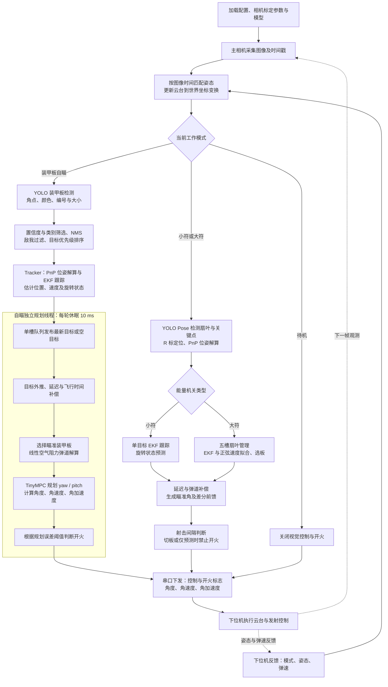
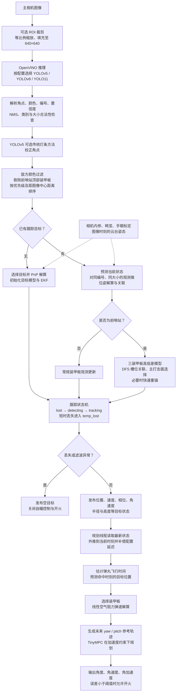

# Climber Vision 2026 步兵视觉方案流程图

根据当前步兵源码梳理。总览以默认启动脚本使用的 `src/standard.cpp` 为主线，覆盖装甲板自瞄、小符和大符；`src/infantry.cpp` 是仅装甲板自瞄的另一入口。

## 1. 整体视觉流程

## 2. 装甲板自瞄细节

说明：PnP 与世界坐标变换封装在 `Solver` 中，由 `Tracker` 调用；图中拆开表示算法步骤。短时丢失仍可能返回预测目标，完全丢失或异常时才发布空目标。非平衡目标还会进行重投影误差驱动的 yaw 优化。

## 3. 对照源码

| 功能 | 主要文件 |
|---|---|
| 默认启动入口及模式切换 | `scripts/auto_start.sh`、`src/standard.cpp` |
| 装甲板检测与后处理 | `tasks/auto_aim/yolo.cpp`、`tasks/auto_aim/yolos/` |
| 位姿解算、标定参数与坐标变换 | `tasks/auto_aim/solver.cpp` |
| 目标选择、跟踪状态机 | `tasks/auto_aim/tracker.cpp` |
| EKF 目标模型、前哨站槽位关联 | `tasks/auto_aim/target.cpp` |
| 自瞄预测、弹道与 TinyMPC | `tasks/auto_aim/planner/planner.cpp` |
| 线性空气阻力弹道 | `tools/air_resist_trajectory.cpp` |
| 能量机关检测与解算 | `tasks/auto_buff/buff_detector.cpp`、`tasks/auto_buff/buff_solver.cpp` |
| 能量机关跟踪与旋转预测 | `tasks/auto_buff/buff_target.cpp` |
| 大符扇叶管理与目标选择 | `tasks/auto_buff/buff_big_group.cpp` |
| 能量机关瞄准与射击时序 | `tasks/auto_buff/buff_aimer.cpp` |
| 云台反馈、时间姿态匹配与串口下发 | `io/gimbal/gimbal.cpp` |

## 4. 阅读时需要区分的实现

- 默认启动脚本指向 `standard` 和 `configs/infantry_5.yaml`，该配置选择 **YOLOv5 + GPU**。YOLOv8 和 YOLO11 是可配置的其他实现。
- `standard` 支持自瞄、小符、大符和待机模式；`infantry` 入口只运行装甲板自瞄。
- 自瞄 `Planner` 实际调用 **TinyMPC 优化器**。能量机关函数虽然名为 `mpc_aim`，当前实现通过预测角度及差分计算角速度、角加速度，并未调用 TinyMPC。
- 自瞄规划线程每轮休眠 10 ms，实际频率还取决于计算耗时；打符在 `standard` 主循环中随图像帧处理。
- 图示基于源码静态分析，未连接相机和下位机进行实车验证。
